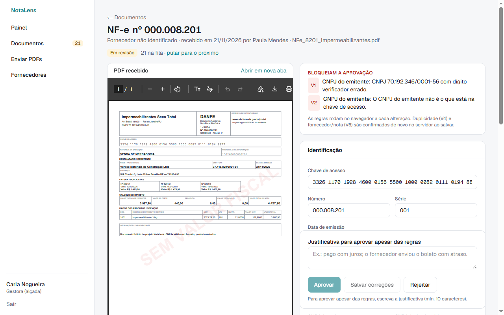
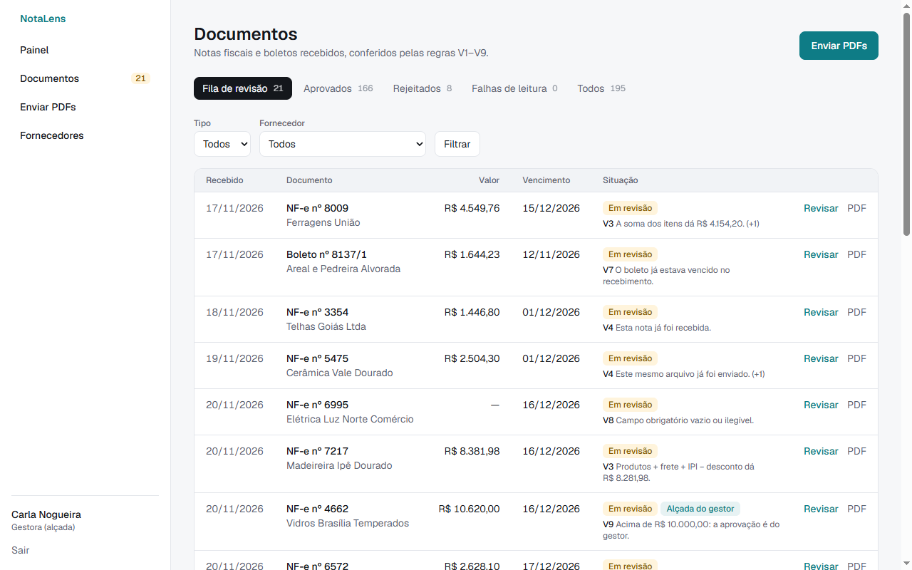
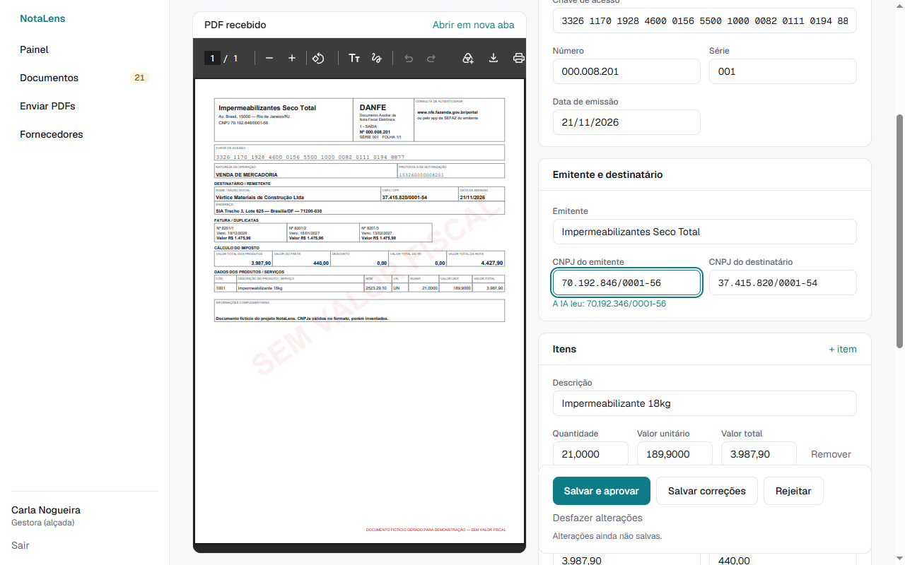
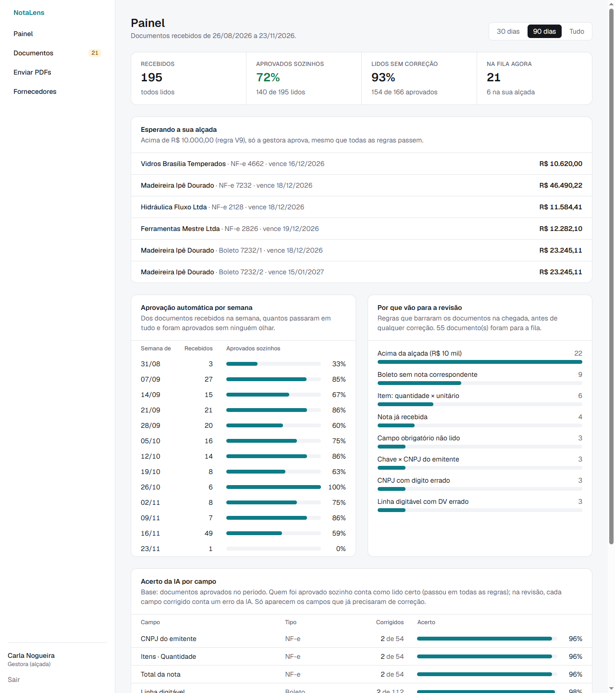

# NotaLens

Extração de notas fiscais (DANFE da NF-e) e boletos com IA, **conferida por regras de negócio**. A IA lê o PDF, e regras determinísticas conferem o que ela leu. O que não fecha vai para uma pessoa revisar, e cada correção vira métrica de acerto da IA por campo.

O cenário é o contas a pagar do **Grupo Vértice**, uma rede fictícia de lojas de materiais de construção.

**106 testes** · **10 regras de validação** · **2 papéis** (analista, gestora) · Claude API + Next.js 16 + PostgreSQL



## O problema

No contas a pagar, alguém abre cada PDF de nota fiscal e de boleto e digita os dados no ERP. Uma IA lê esses documentos bem, mas não é perfeita: troca um dígito do CNPJ, pula uma linha de item, lê 8 onde está 3. Se o resultado for direto para o ERP, um erro raro vira pagamento errado.

O NotaLens usa a IA para o trabalho repetitivo e **não a deixa ter a última palavra**:
- **A IA só copia o texto impresso.** Converter valores, conferir dígitos verificadores e somar itens é código determinístico, testado.
- **Regras conferem tudo o que foi lido.** Um documento que passa em todas e está dentro da alçada é aprovado sozinho; os outros vão para a fila.
- **A revisão mede a IA.** Cada campo corrigido guarda o que a IA leu e o valor final, e isso vira o acerto por campo no painel.

## As regras

| # | Regra |
|---|---|
| V1 | CNPJs do emitente e do destinatário com dígitos válidos (inclusive o **CNPJ alfanumérico**, vigente desde jul/2026); o destinatário é uma empresa do grupo |
| V2 | Chave de acesso da NF-e com 44 dígitos e DV módulo 11, conferida com o CNPJ do emitente, o número, a série e o mês de emissão |
| V3 | As contas fecham: quantidade × unitário em cada item, soma dos itens, total da nota e parcelas (tolerância de 1 centavo por item) |
| V4 | Duplicidade: a mesma chave, a mesma linha digitável ou o mesmo arquivo já recebido |
| V5 | Linha digitável do boleto com DVs módulo 10 e 11; o valor e o vencimento codificados nela batem com os campos |
| V6 | Fornecedor cadastrado e ativo; o boleto casa com uma nota do mesmo fornecedor pelo total ou por uma parcela |
| V7 | Vencimento não está no passado; faltando menos de 3 dias úteis, o documento ganha o alerta "urgente" |
| V8 | Campos obrigatórios presentes; um campo que a IA não conseguiu ler bloqueia |
| V9 | Alçada: acima de R$ 10.000,00 só a gestora aprova, mesmo com tudo certo |
| V10 | Dinheiro em centavos inteiros, quantidades com 4 casas em inteiros, datas como texto ISO: nenhum float |

Os testes leem como a regra. Um trecho de [`identificadores.test.ts`](src/domain/documentos/__tests__/identificadores.test.ts):

```ts
it("fator de vencimento: virada de 21/02/2025 (9999) para 22/02/2025 (1000)", () => {
  expect(dataParaFator("2025-02-21")).toBe(9999);
  expect(dataParaFator("2025-02-22")).toBe(1000);
  // o mesmo fator 1000 é decodificado pela data de referência
  expect(fatorParaData(1000, "2000-06-01")).toBe("2000-07-03");
  expect(fatorParaData(1000, "2025-02-01")).toBe("2025-02-22");
});
```

## Como funciona

### Envio e fila

A analista envia um lote de PDFs. Cada arquivo passa por **leitura → normalização → regras** e sai aprovado sozinho, na fila de revisão ou como falha de leitura, com o motivo. A fila mostra os urgentes primeiro e, em cada linha, a regra que barrou o documento.



### Revisão

O PDF fica ao lado dos campos lidos, e as regras que falharam aparecem no topo e no próprio campo. **As regras rodam no navegador a cada tecla**, com o mesmo código do servidor: ao corrigir o CNPJ, a revisora vê na hora que o documento passou. Embaixo de cada campo alterado fica o que a IA tinha lido.



Ao salvar, o servidor roda as regras de novo, com duplicidade e fornecedores atualizados, e grava as correções. A analista não aprova acima da alçada nem com uma regra bloqueando. A gestora pode aprovar apesar de uma regra (um boleto vencido que será pago com juros, por exemplo), mas precisa escrever a justificativa, que fica na auditoria.

### Painel da gestora

Mostra:
- a taxa de aprovação automática por semana;
- por que os documentos vão para a revisão: as regras que os barraram **na chegada**, lidas da auditoria, porque as violações atuais mudam com as correções;
- o acerto da IA por campo;
- o tempo e o custo de cada leitura real;
- a fila da alçada.

A gestora também mantém o cadastro de fornecedores que a regra V6 consulta.



## Como a IA é usada

A leitura fica atrás de uma interface `Extrator`, com duas implementações:

- **`ExtratorClaude`** ([`claude.ts`](src/server/extracao/claude.ts)):
  - envia o PDF inteiro à API do Claude como bloco `document`;
  - recebe um **JSON com schema fixo** (structured outputs), validado pelo SDK com Zod;
  - modelo padrão `claude-sonnet-5-5`, com esforço baixo, porque copiar campos é tarefa simples.
- **`ExtratorGravado`** devolve as respostas que o seed gravou para cada PDF, pelo hash. Com ele, **a demo inteira roda sem chave de API e sem custo**.

Decisões:
- **Copiar, não interpretar.** O prompt pede o texto como impresso ("1.234,56", "21/11/2026") e `null` para o que estiver ilegível. A conversão para centavos e datas ISO é do código, que pode ser testado; a IA não decide nada.
- **Prompt injection.** O conteúdo do PDF é tratado como dado, e a saída passa por schema rígido e pelas regras. Um PDF com instruções escondidas, no máximo, produz campos errados, e as regras mandam para a revisão.
- **Falha não vira aprovação.** Recusa do modelo, resposta cortada, erro de API ou arquivo que não é NF-e nem boleto viram "falha de leitura", com o motivo.
- **Medido.** Cada leitura grava modelo, tokens e tempo. O painel transforma isso em custo estimado por documento.

## Decisões de engenharia

**O domínio é código puro.** Regras, CNPJ, chave de acesso, linha digitável e normalização ficam em `src/domain/documentos/`, sem banco e sem framework. O mesmo `decidir(documento, contexto)` roda no upload, na revisão (no navegador) e no servidor ao salvar. O contexto traz só o que a regra precisa: CNPJs do grupo, fornecedores, notas do mesmo fornecedor e o que já foi recebido.

**Identificadores brasileiros por completo:**
- CNPJ alfanumérico (cada caractere vale o código ASCII − 48);
- chave de NF-e com DV módulo 11;
- linha digitável com DVs módulo 10 e 11;
- fator de vencimento que reiniciou em 22/02/2025, decodificado pelo ciclo mais próximo da data de recebimento.

**Duplicidade sem condição de corrida.** As regras rodam dentro de uma transação `Serializable`, repetida em caso de conflito. Assim, duas pessoas enviando a mesma nota ao mesmo tempo não passam as duas pela V4.

**O seed é um teste de ponta a ponta.** Ele gera ~195 PDFs de DANFE e boleto com `pdf-lib` e grava, para cada um, a resposta da "IA", incluindo leituras erradas de propósito. Os defeitos também são de propósito: soma que não fecha, nota duplicada, boleto vencido, boleto falso de um CNPJ fora do cadastro e fornecedor inativo. Tudo passa pelo mesmo pipeline da aplicação. Se alguma regra produzir um resultado diferente do planejado para aquele defeito, o seed termina com erro.

**Segurança.**
- O upload só aceita PDF (assinatura `%PDF`, até 5 MB), guardado pelo hash.
- O PDF é servido por uma rota autenticada, com `no-store`.
- A sessão é um JWT (`jose`) num cookie httpOnly, e as senhas usam bcrypt.
- O `proxy` faz uma checagem rápida por papel. Mesmo assim, toda página e toda Server Action confere a sessão e o papel de novo no servidor.

## Estrutura

```
src/
  domain/documentos/   regras V1–V10, CNPJ, chave NF-e, linha digitável, normalização (puro + testes)
  server/extracao/     Extrator, ExtratorClaude, ExtratorGravado
  server/              pipeline, revisão, fornecedores, consultas, auth, storage
  lib/                 métricas do painel (puro + testes), rótulos e formatação
  app/                 rotas: login, documentos, enviar, revisão, painel, fornecedores
prisma/                schema, migrações e seed (gera os PDFs e as leituras gravadas)
docs/design.md         design original, regras e decisões
```

## Rodar localmente

Pré-requisitos: Node 22+ e Docker.

```bash
cp .env.example .env        # gere um SESSION_SECRET novo (instrução no arquivo)
npm install
npm run db:up               # PostgreSQL 16 na porta 5435
npm run db:migrate
npm run db:seed             # gera os PDFs em storage/ e 6 exemplos em amostras/
npm test                    # 106 testes
npm run dev
```

**Contas de demonstração** (senha `vertice123`, só para uso local):

| Papel | E-mail |
|---|---|
| Gestora (alçada) | `carla.nogueira@vertice.test` |
| Analista | `paula.mendes@vertice.test` |

Para testar o envio, use os PDFs da pasta `amostras/`. Sem `ANTHROPIC_API_KEY`, a leitura usa as respostas gravadas. Com a chave no `.env`, cada PDF é lido pelo Claude; o modelo pode ser trocado em `ANTHROPIC_MODEL`, e `NOTALENS_EXTRATOR=gravado` força a demo.

## Limitações conhecidas

- **IA real:** a integração com o Claude é coberta por testes com um cliente simulado (o que é enviado, o tratamento de cada erro, a soma de tokens). A demo e as métricas do seed usam as leituras gravadas.
- **PDFs digitalizados:** os documentos do seed são PDFs com texto. Fotos e digitalizações tortas não foram avaliadas.
- **Acerto da IA:** conta como certo o documento aprovado sozinho. Um erro que passasse em todas as regras não apareceria na métrica; por isso as regras cruzam campos entre si (chave × CNPJ × número, linha digitável × valor × vencimento).
- **Escopo:** uma empresa só, sem integração com ERP e sem deploy (roda localmente).

Os PDFs são **fictícios** e marcados como "sem valor fiscal"; os CNPJs são válidos no formato, mas inventados.

## Stack

Next.js 16 (App Router, Server Actions, Cache Components) · TypeScript · Claude API (`@anthropic-ai/sdk`, structured outputs) · PostgreSQL 16 · Prisma 7 · Zod · Vitest · Tailwind CSS 4 · pdf-lib
